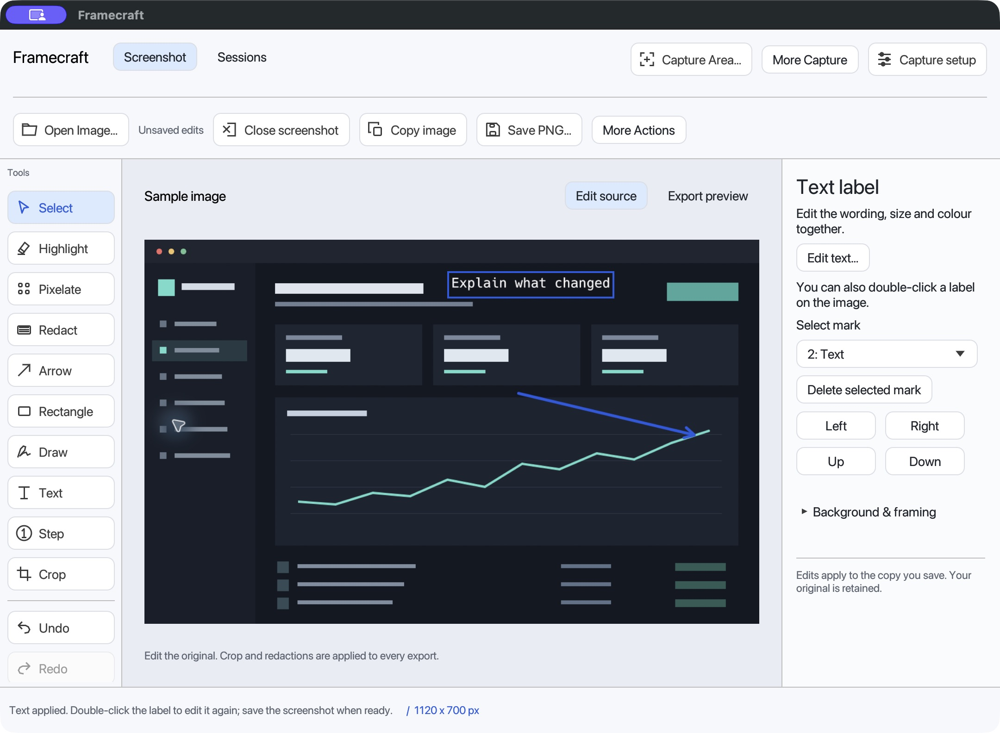
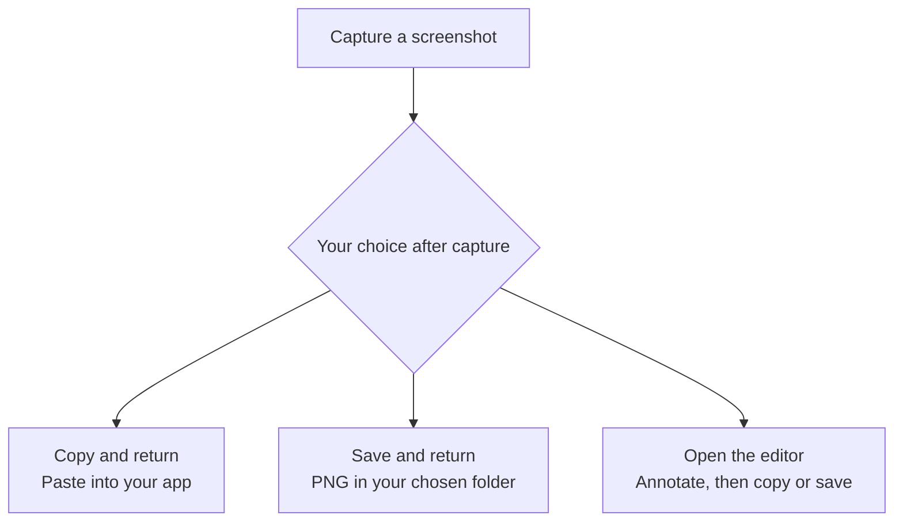
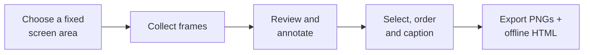
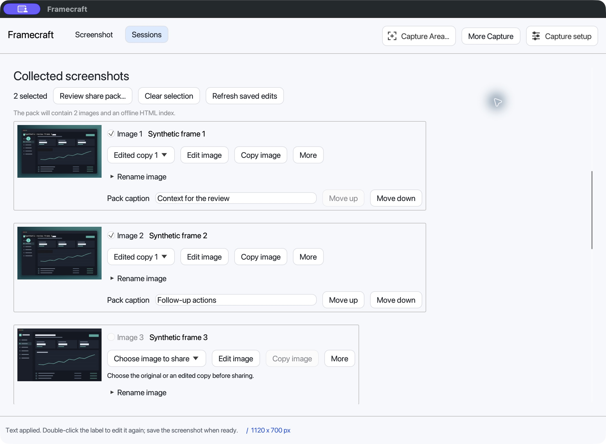

# Framecraft

**Capture a screenshot, explain the detail and share it from your Mac.**

Framecraft brings everyday screen capture and multi-image review into one local-first Mac app. Grab an area and paste it into the app you're using. When an image needs context, add an arrow, a label or a redaction before sharing it. For a presentation or a longer walkthrough, collect a series of frames and turn the useful ones into an ordered, captioned pack.

It's built for the work around a screenshot: explaining a bug, documenting a process or passing on the relevant parts of a meeting. Capture, editing and text recognition run on your Mac. There's no account to create or Framecraft cloud service to upload to.

**[Download the Mac beta](https://github.com/jonathan-tipper/framecraft/releases/tag/v0.3.0-beta.6)** · [Get started](#get-started) · [Customer FAQ](#customer-faq)

Current release: **0.3.0-beta.6**, for Apple silicon. The beta is ad-hoc signed and isn't Apple-notarised; macOS may require first-launch approval. [Installation details](docs/INSTALLATION.md).



*The native Mac editor, showing generated sample content. Add context with the tool rail, adjust a selected mark in the inspector, then copy or save the result.*

## How it works

### For a quick screenshot

Choose what should happen after capture in **Capture setup**. Use your recorded shortcut or the menu bar icon to capture an area. Window and primary-screen capture are also available from the menu.



**Copy and return** puts the screenshot on this Mac's clipboard; press **⌘V** to paste at the cursor in an app that accepts images. **Save and return** writes a PNG and leaves your clipboard alone. You can still choose **Edit Last Capture…** from the menu bar to annotate your latest direct grab.

### For a set of screenshots

Open **Sessions → Start a new collection**. Choose a screen area, save folder and collection mode. Collect frames manually, on a timer or when the content changes, then return to review them together.



Choose an original or edited copy for each frame, select the ones you want, and use **Review share pack…** to check the output before exporting. The pack opens in a browser without Framecraft or an account.



*Session review with generated sample frames. Each image has an explicit choice of original or edited copy before sharing.*

## Get started

You don't need Rust or developer tools to use the downloaded app.

1. **Install.** [Download beta 6](https://github.com/jonathan-tipper/framecraft/releases/tag/v0.3.0-beta.6), open the DMG and drag **Framecraft** into **Applications**. Eject the disk image and open the installed app. If macOS blocks it, use **System Settings → Privacy & Security → Open Anyway** after the first launch attempt. The [installation guide](docs/INSTALLATION.md) covers checksums, updates and managed Macs.
2. **Allow screen capture.** Open **Capture setup** and follow the screen-access step. macOS controls Screen Recording permission; Framecraft can't approve it for you. Quit and reopen the app if macOS asks.
3. **Choose your controls.** Select **Record shortcut** and press your preferred key combination, or choose **Use menu bar only**. On the final step, choose **Copy and return** and finish setup. Keep Framecraft running.
4. **Capture and paste.** Place the cursor in an app that accepts images. Press your shortcut, drag a rectangle, then press **⌘V** to paste. **Escape** cancels selection. Here, ⌘ means Command. If you chose menu bar only, use **Capture Area…** from Framecraft's menu bar icon.

To try editing before granting screen access, choose **Try the editor with a sample image** on the opening screen, or use **Open Image…** with a PNG or JPEG. Neither captures your screen.

If an upgrade leaves screen access blocked, open **More Capture → Screen Access…** and check which copy is running. The [permission recovery steps](docs/INSTALLATION.md#allow-capture) explain how to repair a stale macOS entry.

## Customer FAQ

### Who is Framecraft for?

People who use screenshots to explain something: a developer reporting a bug, a product team reviewing a screen, a colleague writing instructions, or someone collecting key frames from a presentation. You can use it for a single image; sessions are there when the work needs a sequence.

### What can I add to a screenshot?

Arrows, text labels, numbered steps, rectangles, highlights, freehand drawing, pixelation and opaque redactions. Select a mark to adjust it, or use Undo and Redo while editing. You can crop the image and optionally add a background and framing. **More Actions → Copy Text…** recognises text locally with Apple Vision, lets you review it, then copies it only when you choose.

### How do collection modes work?

| Mode | What it does | Useful for |
| --- | --- | --- |
| **When I click** | Saves a frame when you use Capture now or your session shortcut | Deliberate evidence capture |
| **On a timer** | Captures at a 5–120-second interval, plus processing time | Regular samples of a process |
| **When content changes** | Samples about once per second and saves sufficiently changed, settled pixels | Mostly static presentations |

Returning to Framecraft pauses collection. Stop it before taking a separate one-off screenshot. Default collection limits are 120 elapsed minutes, including pauses, or 500 images; **Collection options** lets you change them.

The capture area is fixed: **it doesn't follow a moving window**. Stop and reselect after moving content or changing displays. Change detection compares pixels, so small changes, low contrast and animation can cause misses or duplicates. Review the collection before relying on it as a record.

### What can I send to someone else?

Copy a single image, save a PNG, or export a reviewed share pack. A pack is a folder containing only the selected flattened PNGs, your captions and an offline `index.html`. Keep those files together when sending it. Recipients can open the HTML in their browser or use the PNGs directly. Framecraft doesn't create hosted sharing links.

### Do my screenshots leave my Mac?

Framecraft doesn't send screenshots or recognised text to a cloud service. Capture, editing and OCR run locally. You choose the save destinations and when to copy or export. Cloud-synchronised folders, clipboard managers and receiving apps can retain or upload their own copies.

**Copy and return** uses a Mac-only pasteboard, excluding that copy from Universal Clipboard. Copying explicitly from the editor uses the ordinary system clipboard. Capture briefly writes a full-display image to a private temporary folder before cropping; prepared drag files remain in temporary storage until exit. Cleanup is best effort and doesn't securely erase data. See the [storage details](docs/USER-GUIDE.md#troubleshooting-and-storage).

### Does redaction remove the original?

**No. Session originals stay in your chosen folder.** An opaque redaction covers pixels in the flattened output; it doesn't delete the source image. Share the selected edited copy or reviewed pack, rather than the whole session folder. Use **Redact** for information that must be covered. Pixelation isn't guaranteed concealment.

### Can I come back and change an annotation later?

You can revise marks and undo changes while the document is open. **Saved PNGs are flattened**: reopening one doesn't restore editable labels, shapes or undo history. Sessions retain original and saved edited images for review, but beta 6 has no persistent editable-project format. Copying an image doesn't save a file; save a PNG before closing if you want to keep it.

### Which Macs can run the beta?

The downloadable DMG is for **Apple silicon Macs**. The app targets **macOS 13 or later**; recorded native testing is on **macOS 26.6.2**. Older versions haven't been verified. Separate-Mac installation, Intel, multiple physical displays and VoiceOver checks remain open in the [test notes](docs/TEST-NOTES.md).

### What else should I know before trying it?

This beta has no scrolling capture, video or audio recording, or account sync. Colour-managed HDR and wide-gamut output aren't supported. Some characters in text labels display as `?`; OCR quality and language support depend on Apple Vision. The [user guide](docs/USER-GUIDE.md) and [release notes](docs/RELEASE-NOTES-0.3.md) cover the current limits.

### Is Framecraft open source?

Yes. The original application code is [MIT licensed](LICENSE), and the beta doesn't require an account or subscription. The app is built in Rust with egui/eframe. See the [dependency inventory](docs/DEPENDENCIES.md) and [third-party notices](docs/THIRD-PARTY-NOTICES.md) for bundled components.

## Build from source

On a Mac with stable Rust and Apple's command-line developer tools:

```sh
git clone https://github.com/jonathan-tipper/framecraft.git
cd framecraft
./scripts/bundle-macos.sh
./scripts/install-macos.sh
open /Applications/Framecraft.app
```

For an existing installation, quit Framecraft and use `./scripts/install-macos.sh --replace`. To run the sample editor directly from source:

```sh
cargo run --locked --release -- --demo
```

The [developer guide](docs/DEVELOPER-GUIDE.md) covers synthetic sessions, offline sample packs, packaging and development checks.

## Help and feedback

- [Installation](docs/INSTALLATION.md) and [user guide](docs/USER-GUIDE.md): setup, controls, sharing and recovery.
- [Worked example](docs/WORKFLOW.md): collect a project review and turn selected frames into an evidence pack.
- [Product direction](docs/PRODUCT.md): scope, planned evaluation and current decisions.
- [Architecture](docs/ARCHITECTURE.md), [testing guide](docs/TESTING.md) and [recorded results](docs/TEST-NOTES.md): implementation and evidence behind the beta.

[Report a problem or suggest an improvement](https://github.com/jonathan-tipper/framecraft/issues). Include the version, macOS version and what you expected to happen. Use sample content where possible.
