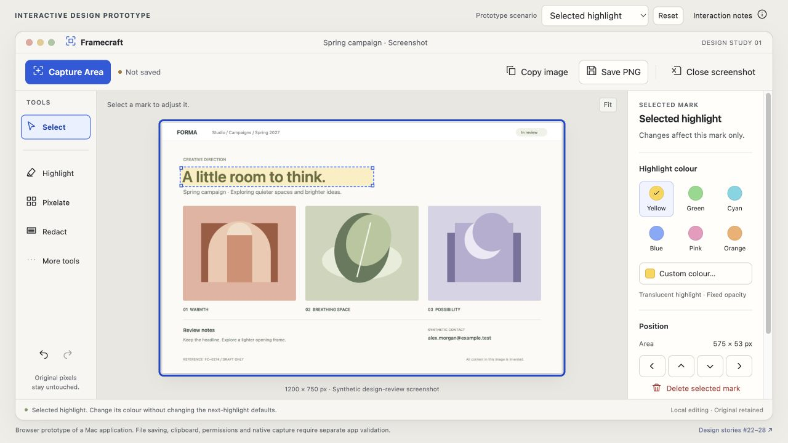
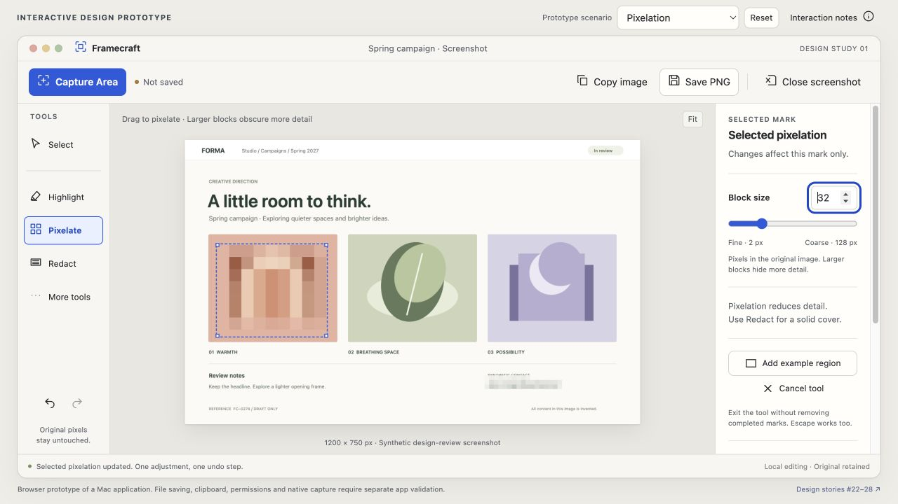
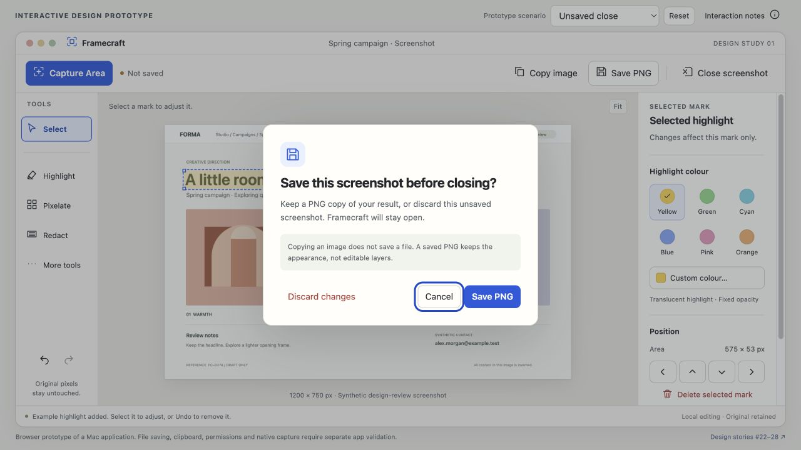
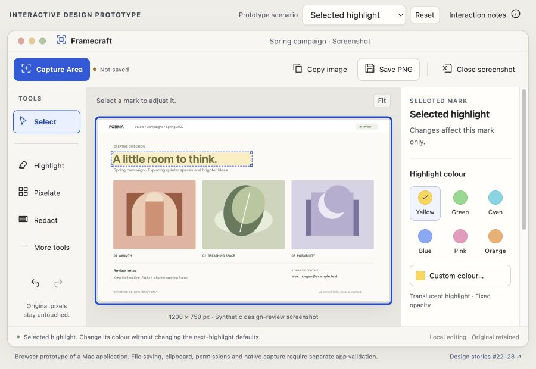

# Framecraft editor prototype

A clickable design candidate for [epic #22](https://github.com/jonathan-tipper/framecraft/issues/22) and stories #23–#28. It explores a canvas-led editor inspired by specific Form Atlas workbench, inspector and labelled-rail studies. Read the [design and interaction contract](../../specs/editor-experience-prototype.md) for references, tokens, flows and acceptance mapping.

This is a browser prototype, not the installed Mac application. All screenshots are synthetic. Capture, Save and Copy demonstrate UI decisions and are labelled simulations; they do not capture your desktop, write PNGs or change the clipboard. State is in memory and is discarded by reset/reload. Simulated area selection returns the full synthetic fixture after selection; it does not crop a new image.

## Open it

Open [index.html](index.html) directly in a modern browser. It is a self-contained file with no package installation, external font or network service. GitHub displays its source rather than running the prototype; download the file first.

Alternatively, from the Framecraft repository root:

```sh
python3 -m http.server 8767 --bind 127.0.0.1 --directory docs/prototypes/editor
```

Then open [the local prototype](http://127.0.0.1:8767/). Stop the server with Ctrl+C when finished. This serves only the prototype directory on the local machine.

## Review states

Use **Prototype scenario** and **Reset** outside the app frame. Changing a scenario deliberately resets a synthetic fixture; it is not the proposed app's ordinary navigation. **Interaction notes** explains the demonstration's controls and limits.

| State | Direct local link |
| --- | --- |
| Empty capture | [#empty](index.html#empty) |
| Edit sample | [#editor](index.html#editor) |
| Simulated area selection | [#capture](index.html#capture) |
| Selected highlight | [#highlight](index.html#highlight) |
| Pixelation and block size | [#pixelate](index.html#pixelate) |
| Unsaved close decision | [#close](index.html#close) |
| Simulated save failure | [#save-error](index.html#save-error) |
| Session-origin screenshot | [#session](index.html#session) |

Review at 1200 × 800 and 900 × 620 browser viewports. Browser framing is separate from the candidate application chrome. A narrower layout supports convenient review; it does not propose a mobile product.

## Screens and review evidence

The [review record](VERIFICATION.md) separates exercised interactions, corrected defects and remaining native checks. These images show the browser prototype, not the installed application.

| Highlight and explicit colour target | Adjustable pixelation |
| --- | --- |
|  |  |

| Cancel, save or discard | Minimum review size, 900 × 620 |
| --- | --- |
|  |  |

Additional states: [empty](screenshots/empty.jpg), [editor](screenshots/editor.jpg), [capture selection](screenshots/capture.jpg), [save failure](screenshots/save-error.jpg), [session image](screenshots/session.jpg), [return to session](screenshots/session-return.jpg).

## Try the important distinctions

1. Start Empty, choose Capture Area and cancel the simulated selector. Repeat and complete a selection.
2. Choose Highlight or Pixelate. Draw a region or use the keyboard-accessible example-region control. Compare **Next** tool defaults with **Selected** object properties.
3. Change a highlight colour or pixelation block size. Cancel a pending adjustment and try Undo after a committed one.
4. Use Cancel tool to return to Select without deleting marks. During a held drag, Escape cancels; after release, use Undo.
5. Copy, then Close screenshot. Copy does not remove the unsaved decision. Try Cancel, Discard changes and Save.
6. Open Save failure and confirm the screenshot remains available after the simulated failure.
7. Open Session origin and close the screenshot to review the return context.

Use the full [review script](../../specs/editor-experience-prototype.md#review-script) to record outcomes, focus behaviour and misunderstandings. Unimplemented demo tools must remain visibly unavailable rather than pretending to perform an action.

## What this does not prove

The prototype cannot establish native Mac capture cancellation, Screen Recording permission recovery, file-system durability, clipboard/drag behaviour, session persistence, compositor privacy invariants, supported-Mac compatibility or VoiceOver conformance. Browser focus/semantics can be reviewed but do not replace native accessibility testing.

The stories remain future Backlog work until their own readiness and acceptance evidence exist. A design candidate can be revised after feedback without claiming that the native features shipped.
