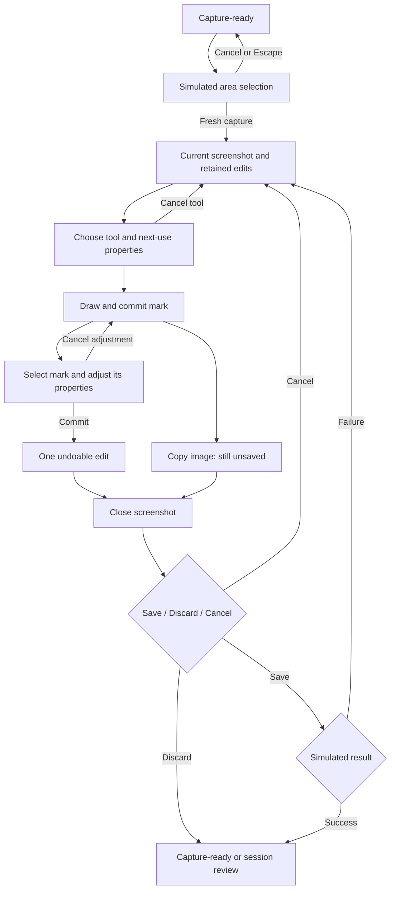

# Editor experience: design candidate and prototype contract

## Status and source of truth

**Design direction adopted for native implementation, 31 October 2026. Native acceptance remains pending.** See the [native editor contract](editor-native-experience.md) and [recorded implementation checks](../TEST-NOTES.md) for beta 3 development evidence. This browser prototype remains a reference and does not itself become the Mac app.

[Epic #22](https://github.com/jonathan-tipper/framecraft/issues/22) owns the shared product rules. Issues [#23](https://github.com/jonathan-tipper/framecraft/issues/23), [#24](https://github.com/jonathan-tipper/framecraft/issues/24), [#25](https://github.com/jonathan-tipper/framecraft/issues/25), [#26](https://github.com/jonathan-tipper/framecraft/issues/26), [#27](https://github.com/jonathan-tipper/framecraft/issues/27) and [#28](https://github.com/jonathan-tipper/framecraft/issues/28) own their numbered acceptance criteria. This spec makes their proposed UI and interaction design concrete. SDD level: **Spec-first**.

The [clickable prototype](../prototypes/editor/index.html) is a synthetic browser demonstration of this proposal. [Running and reviewing it](../prototypes/editor/README.md) explains the scenarios and limitations. GitHub displays HTML source; download/open the file or serve it locally to interact with it.

The prototype does not replace the installed Rust application. The [beta2 Mac experience](0.3-mac-experience.md), [session/output contract](0.3-session-workbench.md) and [recorded native checks](../TEST-NOTES.md) still describe the shipped beta. Issue acceptance remains unchecked until the relevant implementation and evidence exist. A browser interaction is not proof of native macOS feasibility.

## Product outcome and users

A Mac user can turn one screenshot into a clear explanation, correct a mistake and leave editing without quitting or losing unconfirmed work. The image should feel like the main workspace, with familiar tools and relevant properties close to it.

The primary flow is one-off capture → annotate → copy/save → close. A secondary entry opens a saved session frame and returns to its review context. Sessions remain available but do not dominate the one-off task.

The six complaints are direct feedback from one user. They justify this design investigation; they do not establish a general preference, successful pilot or performance improvement.

## Which designs this follows

This is one coherent proposal inspired by specific Form Atlas studies, not a copy of that app or a selected off-the-shelf design system. Use the committed [Form Atlas reference](https://github.com/jonathan-tipper/form-atlas/tree/cbdd4a1d189690c5aea5b0906a396b6c22a11b9b). Its [README](https://github.com/jonathan-tipper/form-atlas/blob/cbdd4a1d189690c5aea5b0906a396b6c22a11b9b/README.md) describes illustrative studies, not measured usability evidence.

| Reference | What Framecraft adopts | Deliberate boundary |
| --- | --- | --- |
| [d35 Monochrome project workbench](https://github.com/jonathan-tipper/form-atlas/blob/cbdd4a1d189690c5aea5b0906a396b6c22a11b9b/dist/data/aesthetics.json#L1360) | Dominant canvas, compact tools, restrained surface hierarchy | No project-management dashboard around the screenshot |
| [d39 Live object inspector](https://github.com/jonathan-tipper/form-atlas/blob/cbdd4a1d189690c5aea5b0906a396b6c22a11b9b/dist/data/aesthetics.json#L1520) | Relevant controls, current values, explicit selected object | No generic control panel showing ineffective properties |
| [a52 Collapsible labelled side rail](https://github.com/jonathan-tipper/form-atlas/blob/cbdd4a1d189690c5aea5b0906a396b6c22a11b9b/dist/data/type.json#L1793) | Recognisable icons alongside words and a clear active tool | No unexplained icon-only default |
| [c24 Settings with live preview](https://github.com/jonathan-tipper/form-atlas/blob/cbdd4a1d189690c5aea5b0906a396b6c22a11b9b/dist/data/product.json#L946) | Immediate effect, recoverable adjustment, explicit target | No preview value left behind after Cancel |
| [j07 Palette sampling loupe](https://github.com/jonathan-tipper/form-atlas/blob/cbdd4a1d189690c5aea5b0906a396b6c22a11b9b/dist/data/authoring.json#L249) | Tangible colour swatches and a visible current colour | No new eyedropper or palette-library feature |
| [j18 Parametric icon forge](https://github.com/jonathan-tipper/form-atlas/blob/cbdd4a1d189690c5aea5b0906a396b6c22a11b9b/dist/data/authoring.json#L700) | Consistent icon stroke, geometry and optical weight | Original small SVG vocabulary, not copied reference artwork |

On 31 October 2026, the six pinned study HTMLs were rendered from an isolated extraction and visually inspected in the in-app browser. This supports the reference interpretation below, not a usability or native feasibility claim. The concrete record is under [Verification](#verification-and-review-gate).

## Visual design contract

Use warm neutral chrome, charcoal text and a single cobalt action accent. The screenshot supplies most of the visual detail. Avoid decorative gradients, floating marketing cards and large ornamental headings. This direction retains the app's blue identity while giving the editor a more deliberate creative-tool composition.

| Role | Prototype token/value | Purpose |
| --- | --- | --- |
| Application chrome | `--chrome: #f7f6f2` | Warm surrounding surface |
| Panels | `--panel: #fffefa` | Tool/inspector surface |
| Canvas surround | `--canvas: #e9e7e1` | Separate screenshot edges from controls |
| Main text | `--ink: #24272b` | Labels and information |
| Supporting text | `--muted: #5e646b` | Secondary instructions, never a disabled-state substitute |
| Separators | `--line: #deded7` | Low-emphasis grouping |
| Primary action/focus | `--accent: #275adf` | Capture, selected emphasis and focus |
| Selection surface | `--accent-soft: #eaf0ff` | Selected tool with additional outline/state |
| Error/destructive text | `--danger: #ad3434` | Error or discard consequence, supported by words |
| Typography | System UI font, 14 px base | Native-like legibility without a new font dependency |
| Geometry | 8 px control, 12 px surface radius | Consistent small-scale shape language |

These are candidate values to inspect, not a claim that all rendered states or usability have passed. Design review targets are at least 4.5:1 for ordinary interface text and 3:1 for essential control boundaries and focus indicators against adjacent surfaces. Measure the actual rendered states, including hover, selection and errors. The [review record](../prototypes/editor/VERIFICATION.md#palette-measurements) contains the measured palette pairs and their limits. Annotation colours are separate from chrome tokens and never recolour source pixels as part of a theme.

### Layout and hierarchy

1. A compact top strip identifies the screenshot and exposes Capture, Copy image, Save PNG and Close screenshot. Save and Copy retain different meanings.
2. A 132 px left rail pairs original line icons with tool names. Select, Highlight, Pixelate and Redact demonstrate the core interactions. Any unimplemented tool is explicitly unavailable in the prototype rather than a misleading working button.
3. The centre canvas takes the remaining width and preserves the screenshot's proportions. Image dimensions and interaction hints are supporting information.
4. A roughly 236 px right inspector explains the current target and only its meaningful properties. Long contextual content scrolls without hiding primary commands.
5. A compact status area gives actual prototype state, such as unsaved changes, cancelled action or simulated save failure.

Review at 1200 × 800 and 900 × 620 browser viewports. The latter is a proxy for the app's minimum size, not evidence of native point scaling. Prototype scenario controls sit outside the app frame and may make the surrounding page scroll. Narrower browser layouts may stack panels for review; this is not a new mobile-product commitment.

Hover, pressed, selected, disabled, focus, busy and error must have intentional states. Focus remains visible; a selected tool also exposes its state semantically. Motion is optional and must not carry essential meaning.

## Screen and scenario inventory

Hashes are review entry points. Selecting a scenario or Reset deliberately restores synthetic fixture state; it is not a production navigation or persistence policy.

| ID | Hash | Purpose and key visible controls |
| --- | --- | --- |
| S01 | `#empty` | Capture-ready state; Capture Area, other capture choices, sample-image entry |
| S02 | `#editor` | Loaded synthetic image; labelled tools, canvas, inspector, Copy/Save/Close |
| S03 | `#capture` | Explicitly simulated selection; draw/use a sample region, Cancel or Escape. Completion returns the full fixture, without cropping. |
| S04 | `#highlight` | Selected highlight; named swatches, Custom colour, explicit target, undo |
| S05 | `#pixelate` | Selected pixelation; Block size, source-pixel units, live effect, undo |
| S06 | `#close` | Unsaved-close decision; Save, Discard changes, Cancel |
| S07 | `#save-error` | Simulated save failure; document retained and useful recovery |
| S08 | `#session` | Synthetic session-origin image; Close returns to review context |

The interaction-notes view is review scaffolding outside the product design. The same applies to scenario selection, Reset and failure simulation. Do not carry them into production application chrome.

## Flow and interaction contract

### Cancel, close and saving

| Situation | Intended result |
| --- | --- |
| Held-pointer drawing/moving | Escape restores the start; release normally commits. Undo recovers a committed mark. No extra Apply click is added to every annotation. |
| Tool selected, no active gesture | Visible Cancel tool/Select returns to Select without deleting committed marks. |
| Colour dialog or other property transaction | Cancel/Escape restores that target's opening value and returns focus to the invoking control. |
| Nested modal/control | Escape affects the nearest active cancellable layer, not the whole document. |
| Close fresh capture or dirty image | Save/Discard changes/Cancel protects unsaved output. Copy is not a durable save. |
| Save fails or is cancelled | Keep the same document and edits; show failure only for an actual failure. |
| Close succeeds | Return to capture-ready or originating session review; keep Framecraft running. |
| Late native save/capture result | Production must check document identity/revision and publication boundary. Browser simulation cannot establish that this is safe. |

Browser Save/Copy controls are simulations and must say so. They do not grant native permissions, write a PNG, populate the clipboard or prove atomic persistence. The simulated success state is useful for reviewing decisions and copy, not for satisfying file-system acceptance.

### Property target and transactions

- **Next highlight / Next pixelation** affects only that tool's defaults and does not dirty the current document.
- **Selected highlight / Selected pixelation** shows that object's actual values. Editing it does not change defaults or other marks.
- A custom colour picker opens from the target's value; confirmation creates one object-edit undo unit, and Cancel restores the opening value.
- A continuous block-size adjustment previews immediately, commits as one interaction and can restore its starting value with Escape.
- Highlight uses named Yellow, Green, Cyan, Blue, Pink and Orange choices plus Custom RGB. The first increment retains 80/255 opacity. Do not expose an ignored alpha control or Weight setting.
- Pixelate uses **Block size**, proposed range 2–128 source pixels and default 12. Larger values are coarser. Invalid typed values must not silently reach rendering.
- Redact stays visibly distinct and opaque. The production compositor must prevent redacted or cropped-out source samples affecting visible pixelation output. A visually convincing browser effect alone does not prove that invariant.

A keyboard-accessible Add example region action supplies a non-drag review path. It is prototype scaffolding, not a substitute for defining native keyboard annotation creation before acceptance.

## Story-to-design traceability

The following mapping covers every current acceptance ID. **Browser target** means an interaction or visual state to inspect in this prototype, not a passed criterion. **Native/implementation evidence** remains required even when the browser target works.

| Story / IDs | Browser target | Evidence still outside this prototype |
| --- | --- | --- |
| #22 E1 | This map and the six owned design sections below | Engineering/spec consistency during delivery |
| #22 E2, E3 | S02 → S04/S05 → S06/S07; repeat capture | Durable file retention and installed-app lifecycle |
| #22 E4, E5 | Error/result wording and pixelation preview illustrate intent | Real async races, atomic publication and hidden-pixel invariance |
| #22 E6 | S01–S08 keyboard, names, minimum-size review | Native accessibility and VoiceOver evidence |
| #22 E7 | Review script below | Actual participant observations and beta2 comparison |
| #22 E8 | Prototype/simulation labels and evidence record | Shipped docs, release and implementation evidence |
| #23 C1, C9 | S02 held drag/Escape, release/Undo, Cancel tool | Native gesture dispatch and crop/move coverage beyond demo |
| #23 C2, C3 | S04 colour dialog and S06 close dialog | Full native nested controls and every property target |
| #23 C4 | S03 simulated selection cancel | Actual system-owned selector, focus/minimise restoration, cleanup |
| #23 C5, C6, C8 | S07/result wording; intended busy states | Cancel/complete races, publication boundaries and cleanup |
| #23 C7 | Focus and accessible names across modal/tool controls | VoiceOver and native busy/completion announcements |
| #24 D1, D2, D3, D6, D9 | S02/S06 close decision, simulated save then close, next capture | Actual button/menu parity, native picker and application lifecycle |
| #24 D4, D5, D7 | S07 retains the document; discard/success demonstrates the branch | Durable intended-revision acknowledgement, retained files, late jobs |
| #24 D8 | S08 close returns to synthetic review | Real session selection/scroll/writer state and missing-origin fallback |
| #24 D10 | S06 focus order, names, Cancel focus return | Native accessibility and VoiceOver |
| #25 P1, P2, P3, P4 | S05 draw/sample region, Block size, target, Cancel/Undo | Exact native source-space geometry, bounds and transaction tests |
| #25 P5, P6, P7 | S05 edge/overlap appearance where implemented | Rust rounding/alpha/crop/masking invariance and bounded work |
| #25 P8, P9 | Simulated output wording and current visual state | PNG/clipboard/drag/pack parity, OCR input and flattened reopen |
| #25 P10 | Labelled slider/numeric controls and keyboard access | Native AX values and VoiceOver |
| #26 H1, H2, H3, H4, H5 | S04 palette/custom RGB, target, rollback and fixed-opacity explanation | Existing native highlights and persisted rendering compatibility |
| #26 H6, H8 | Undo and current visual result | Crop/zoom/output pixel parity and stale-revision handoff |
| #26 H7, H9 | Swatch labels/state and relevant Redact properties | Native semantics and every actual control state |
| #26 H10 | Light/dark synthetic-content walkthrough where provided | Observed unaided use; do not infer success from a screenshot |
| #27 V1 | Reference table, tokens, states and prototype | Chosen-design decision and native implementation fidelity |
| #27 V2, V3, V4, V5 | S01–S08 hierarchy, inspector targets, minimum-size/state inspection | Native layout/scaling and measured contrast in shipped controls |
| #27 V6 | Browser keyboard and non-drag review route | Native essential-task/VoiceOver/reduced-motion coverage |
| #27 V7, V8 | Review script and honest prototype labels | Comparative task results and shipped-guide imagery |
| #27 V9 | Preserved conceptual commands and output boundaries | Capture/session/renderer regression evidence |
| #28 I1, I2, I3, I4 | Visible icon-plus-label vocabulary and control states | Complete native inventory, deployment scales and disabled routing |
| #28 I5, I6, I7 | Browser semantics and original inline SVG approach | Native AX announcements, production assets/licence inventory, guards |
| #28 I8 | Icon meaning questions in review script | Observed errors/assistance and resulting design corrections |

### Design contract to add to each story

These additions are additive. They do not replace existing functional or native acceptance, and they do not close the story.

| Issue | Design-specific requirement |
| --- | --- |
| #22 | Link this spec, runnable prototype and review evidence. Resolve discrepancies between prototype and shared rules explicitly before implementation. |
| #23 | Match the distinct S02 mode/gesture, S03 selection and S04/S06 modal cancellation affordances. State which layer owns Escape and where focus returns. |
| #24 | Match S06/S07 Save/Discard changes/Cancel copy and S08 origin return. Keep Close screenshot visible and distinct from Quit; identify simulation-only controls. |
| #25 | Match S05's labelled Block size and Selected/Next target, with visible actual effect and undo/cancel rules. Keep Redact separate; obtain compositor proof independently. |
| #26 | Match S04's named swatches, custom RGB transaction, selected-state indication and fixed-opacity explanation. Keep ignored Weight/alpha controls absent. |
| #27 | Review this complete screen/state set at minimum and larger sizes, rendered Form Atlas references, tokens and focus states. Record the accepted or revised direction and remaining findings. |
| #28 | Use one command-to-symbol vocabulary with labels and focus/selected states; compare Capture/Crop, Redact/Pixelate and Cancel/Close meanings. Prototype artwork is a candidate, not automatic approval of production assets. |

## Review script

Use synthetic content. Record build/commit, browser/version, viewport/scale, input method and participant familiarity. Do not silently coach the participant; record assistance and failed tasks.

1. Start S01. Ask for a screenshot of an area. Identify whether Capture Area is found before any session/settings control. Cancel S03, then complete the simulated selection.
2. In S02, choose Highlight, select a named colour and add a region. Ask which object or default a colour change will affect. Select an existing mark and recolour only it.
3. Open Custom colour, preview a different colour, then Cancel. Confirm the opening value returns and focus is useful. Repeat with confirmation and Undo.
4. Open S05. Ask for less visible detail. Check whether increasing Block size is understood, whether the value/units are visible and whether Undo returns the previous state.
5. Begin a drag and press Escape while holding the pointer. Then commit a mark and use Undo. Exit the active tool using Cancel tool. The three actions should have different, predictable scopes.
6. Copy the image, then Close screenshot. The simulated clipboard copy must not suppress the unsaved decision. Cancel preserves the image. Try Save, Discard changes and the S07 failure branch separately.
7. Open S08, close the image and confirm return to the synthetic session context. Start another screenshot without treating this as an application restart.
8. Use keyboard only for scenario selection, toolbar, properties and dialogs. Record focus traps, missing names or inaccessible choices; test VoiceOver separately if available.
9. At 900 × 620, inspect every required action and modal decision. Repeat at 1200 × 800. Record clipping, scrolling and controls difficult to find rather than judging only the default screenshot.
10. Ask the participant to explain Capture/Crop, Redact/Pixelate, Copy/Save and Cancel/Close. Record misunderstandings and change decisions.

A completed reviewer walkthrough is formative evidence, not a general claim of improved usability. Compare the same tasks against beta2 before claiming reduced discovery/correction effort. The broader #9 pilot remains separate.

## Verification and review gate

This section must distinguish what was run from what remains intended. Do not mark native issue criteria complete on the strength of browser evidence.

| Evidence to record | Required contents |
| --- | --- |
| Reference review | Rendered study IDs, what was observed, chosen transfer and differences |
| Prototype screenshots | Scenario/hash, viewport, commit, relevant control state; include empty, editor, highlight, pixelation, close and save failure |
| Interaction checks | Action sequence, expected/observed result, keyboard/focus notes and remaining defects |
| Automated checks, if run | Command/tool, scope, results and what was not covered |
| User feedback | Task outcomes, errors, assistance and keep/change decisions |

### Rendered reference review, 31 October 2026

The delivery reviewer inspected the actual pinned HTML studies in the in-app browser:

- **d35:** neutral monochrome surfaces, slim left navigation and aligned central workspace.
- **d39:** a large central object with a narrow live-property inspector to the right.
- **a52:** icons paired with readable navigation words.
- **c24:** compact controls beside immediate preview, using warm off-white surfaces.
- **j07:** explicit swatches and a clearly identified current colour.
- **j18:** consistent stroke and geometry at actual icon sizes.

The chosen transfer is composition, property-to-object mapping and labelled controls. Giant editorial headings, decorative serif type, example code and illustrative study content are not carried into Framecraft. No Form Atlas asset is bundled. This was a visual reference review, not a participant study.

The [prototype review record](../prototypes/editor/VERIFICATION.md) records exercised browser interactions, screenshots, corrected defects and remaining limits. It distinguishes browser demonstrations from production acceptance.

Design can proceed to native implementation planning when the visual direction and interaction differences are recorded, screenshots/states are reviewable, no core prototype contradiction remains, and the affected issue's native feasibility work is named. Successful browser review does not make the six production stories Done or automatically Ready.

## Non-goals and remaining native work

No Rust/egui replacement, new app binary, deployment-baseline change, screen permission flow, real capture, production clipboard/file/drag output, session persistence or hosted service is delivered by this prototype. It uses synthetic content and in-memory state. A page reload/reset discards it deliberately.

Native selection cancellation, file picker and atomic-save behaviour, asynchronous job ownership, actual output pixel invariants, window/menu lifecycle, Retina/display behaviour and native VoiceOver remain engineering validation. Do not imply that HTML semantics transfer directly to egui/AppKit accessibility.

Optional pixelation resize and adjustable highlight opacity remain outside the mandatory first slice unless their stories explicitly adopt them. Form Atlas inspiration does not authorise copying assets or importing dependencies.

## Retires and decision log

This prototype replaces prose-only design ambiguity with a concrete candidate. It retires no production code or user workflow. When the native design ships, remove superseded screenshots/controls through the owning issues rather than keeping two competing UI contracts.

- **2026-10-31:** Created a clickable design candidate tied to #22–#28; preserved P1/P2 priorities and Backlog status. Prototype approval and native feature acceptance remain distinct.
